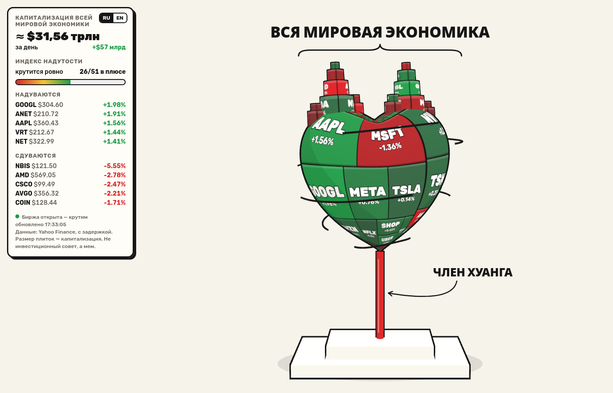
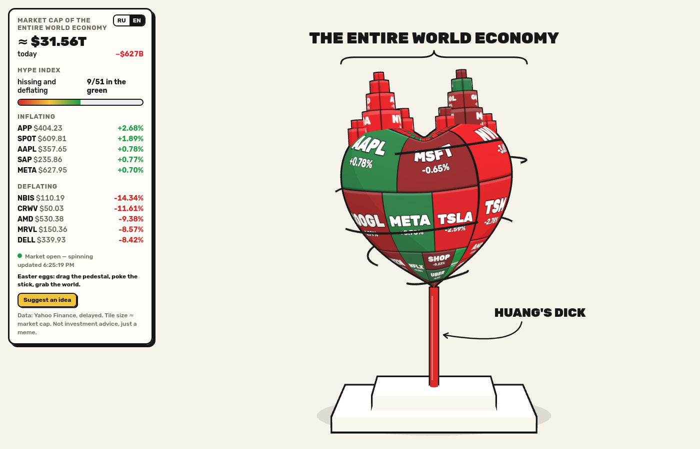
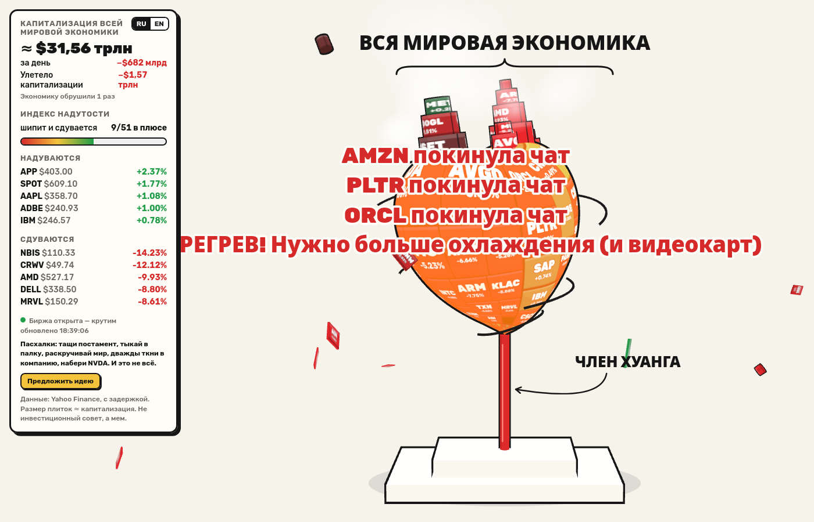
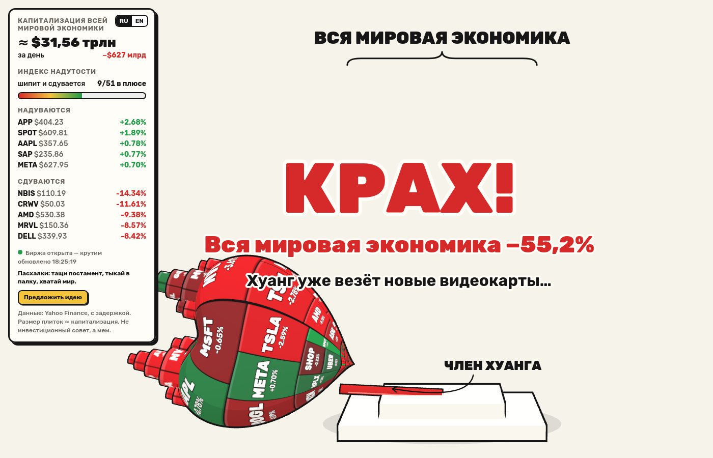
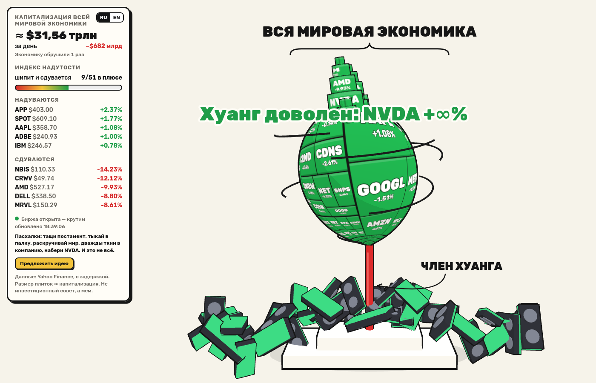
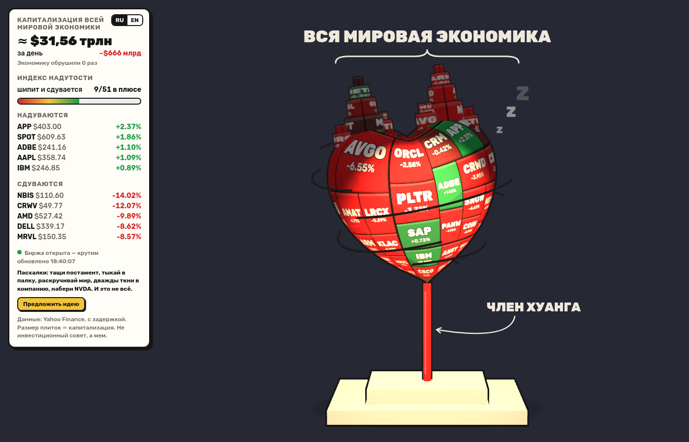
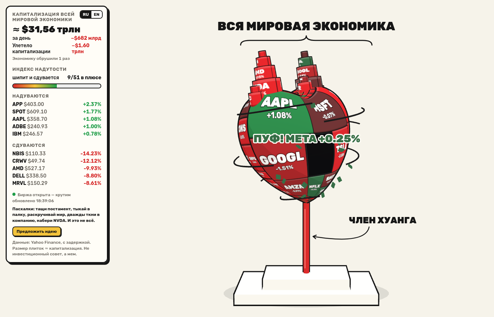
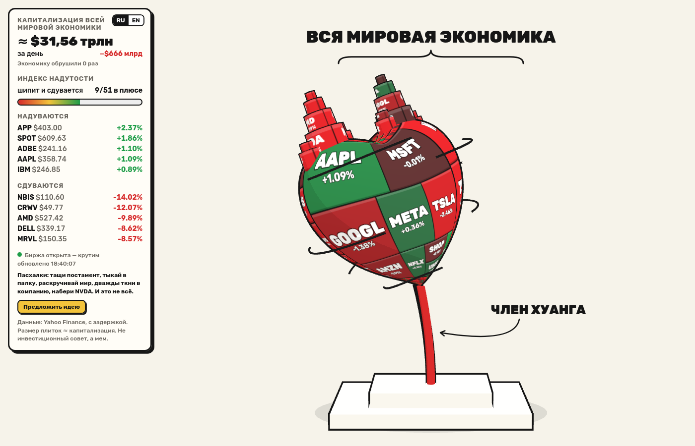
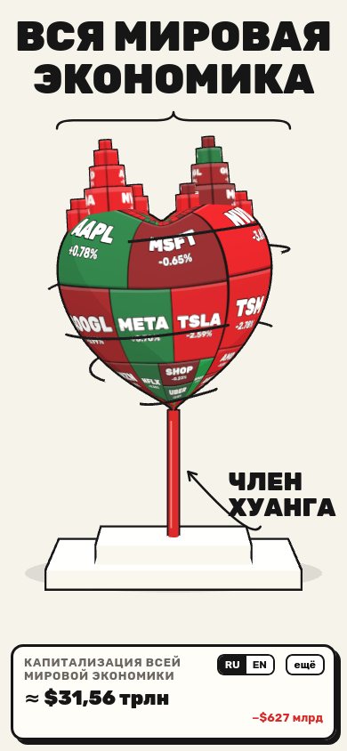

# Jensenomics

**RU** · Шуточный 3D-сайт по мотивам мема: «вся мировая экономика» в виде treemap'а из 51 техкомпании с живыми котировками крутится на палке Хуанга. Чем сильнее штормит рынок, тем быстрее крутится и сильнее шатается. А ещё её можно уронить.

**EN** · A joke 3D website based on a meme: "the entire world economy", a live-quote treemap of 51 tech stocks, spinning on Jensen Huang's stick. The more volatile the market, the faster it spins and the harder it wobbles. You can also knock it over.



<details><summary>English version</summary>



</details>

## Пасхалки / Easter eggs

| | RU | EN |
|---|---|---|
| Постамент | Тащи мышкой или пальцем: мир шатается, но держит баланс. Резкий рывок роняет его. | Drag the pedestal: the world wobbles but keeps balance. Yank it and it falls. |
| Палка | Тыкай в неё: каждый тычок раскачивает. Пара тычков в такт — и всё рушится. | Poke the stick: each poke rocks it. A couple in rhythm and it all comes down. |
| Крен рынка | Пока мир кренится, рядом показан «Крен рынка −N%». | While tilting, a "Market tilt −N%" gauge shows how close it is to falling. |
| Крах | «КРАХ! Вся мировая экономика −xx%», потом Хуанг везёт новые видеокарты и всё чинит. | "CRASH! The entire world economy −xx%", then Jensen ships more GPUs and fixes it. |
| Счётчик крахов | Общий для всех посетителей: «Экономику обрушили N раз». | Shared across all visitors: "World economy crashed N times". |
| Мир | Зажми, чтобы остановить, или раскрути рукой. | Hold it to stop the spin, or spin it by hand. |
| Центробежка | Раскрути сильно — с мира слетают компании, мелкие первыми, на их месте остаются дыры. В панели считается улетевшая капитализация. Через пару секунд покоя индекс ребалансируется. | Spin hard and companies fly off, smallest first, leaving holes. The panel counts the flung-off market cap. Calm down and the index rebalances. |
| Башенки | Ещё быстрее — срываются башенки: «NVDA покинула чат». | Even faster and the towers come off: "NVDA has left the chat". |
| Перегрев | Долгая раскрутка: мир краснеет, валит пар, «Нужно больше охлаждения (и видеокарт)». | Keep spinning: the world glows red and steams. |
| Пузырь | Двойной клик или тап по компании — она раздувается и лопается: «ПУФ!». | Double-click or double-tap a company to inflate and pop it. |
| NVDA | Набери `NVDA` на клавиатуре (в любой раскладке), Konami-код или тапни 5 раз по заголовку — дождь из видеокарт, всё зелёное, «Хуанг доволен». | Type `NVDA` (any layout), the Konami code, or tap the title 5 times: GPU rain, everything turns green. |
| Настоящий рынок | NVDA за день ниже −5% — палка гнётся и дрожит сама. Выше +5% — мир подпрыгивает. | NVDA below −5% today bends and shakes the stick; above +5% makes the world jump. |
| Ночь | Биржа закрыта — темнеет, горит одна лампа, мир крутится медленнее и посапывает «Zzz». | Market closed: lights dim, a single lamp, slower spin and some "Zzz". |
| Тряска | На телефоне встряхни его — это как рывок постамента. | On a phone, shake it to yank the pedestal. |

Есть идея пасхалки? Кнопка «Предложить идею» на сайте ведёт в [issues](https://github.com/btrvodka/jensenomics/issues/new). / Got an idea? The "Suggest an idea" button opens an [issue](https://github.com/btrvodka/jensenomics/issues/new).

<p>
  
  
  
  
  
  
</p>

<p align="center"></p>

## Запуск / Run

```sh
go build -o jensenomics . && ./jensenomics      # http://localhost:8080
./jensenomics -addr :3000 -refresh 30s           # другой порт и частота обновления / custom port & refresh
./jensenomics -demo                              # выдуманные котировки, без интернета / fake quotes, offline
./jensenomics -crash-file data/crashes           # сохранять счётчик крахов между перезапусками / persist the crash counter
```

Нужен Go 1.22+. Фронтенд встроен в бинарник через `embed`.
Requires Go 1.22+. The frontend is embedded into the binary.

### Make

```sh
make run            # собрать и запустить / build & run (PORT=8080 REFRESH=1m)
make demo           # демо-режим / demo mode
make help           # все команды / all targets
```

### Docker

Готовый образ / Prebuilt image (linux/amd64, linux/arm64):

```sh
docker run -d --name jensenomics --restart unless-stopped -p 8080:8080 \
  -v jensenomics-data:/data ghcr.io/btrvodka/jensenomics
```

Счётчик крахов хранится в томе `/data`. / The crash counter lives in the `/data` volume.

Собрать самому / Build yourself:

```sh
make docker-build && make docker-run          # http://localhost:8080
# или напрямую / or directly:
docker build -t jensenomics .
docker run --rm -p 8080:8080 jensenomics
```

## Как это устроено / How it works

- `crashes.go` — общий счётчик крахов: `POST /api/crash` (не чаще раза в 3 с с одного IP), значение отдаётся в `/api/quotes`. / Shared crash counter.
- `quotes.go` — каждые N секунд забирает цену и % изменения за день с Yahoo Finance (`v8/finance/chart`), отдаёт их на `/api/quotes`. / Polls Yahoo Finance and serves `/api/quotes`.
- `tickers.go` — список бумаг, групп и примерных капитализаций (капитализация только задаёт размер плиток). / Ticker list; market caps are rough and only set tile sizes.
- `web/app.js` — сцена на three.js: сердце строится из неявного уравнения поверхности, treemap рисуется на canvas и натягивается текстурой, подписи — 2D-оверлей. Переключатель RU/EN в панели. / three.js scene, canvas-drawn treemap texture, RU/EN switch.
- Физика пасхалок — перевёрнутый маятник с «балансировщиком»: пружина держит палку, рывки постамента и тычки её раскачивают; после порога крена мир слетает и падает с отскоками на постамент и пол. / Easter-egg physics: a self-balancing inverted pendulum; past the tilt threshold the world flies off and bounces off the pedestal and floor.
- Скорость вращения зависит от средней волатильности, покачивание — от падения рынка. / Spin speed follows average volatility, wobble follows market drop.

## Дисклеймер / Disclaimer

Это пародия и мем, не инвестиционный совет. Проект никак не связан с NVIDIA или Дженсеном Хуангом. Данные Yahoo Finance неофициальные и с задержкой.

This is a parody and a meme, not investment advice. Not affiliated with NVIDIA or Jensen Huang. Yahoo Finance data is unofficial and delayed.

## Публикация образа / Publishing the image

- **CI:** пуш тега `v1.2.3` → GitHub Actions публикует `ghcr.io/btrvodka/jensenomics:1.2.3`, `:1.2` и `:latest`. / Pushing a `v*` tag publishes the image via GitHub Actions.
- **Вручную / Manually:** `cp .env.example .env`, вписать `GHCR_TOKEN` (scope `write:packages`), затем `make docker-login && make docker-push`.
